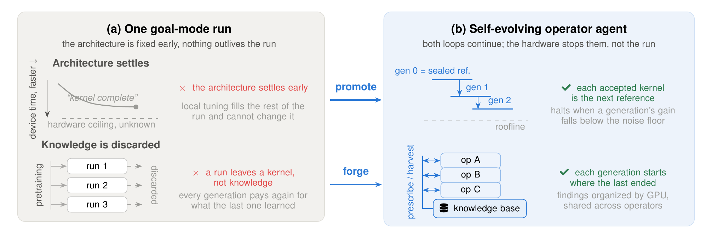
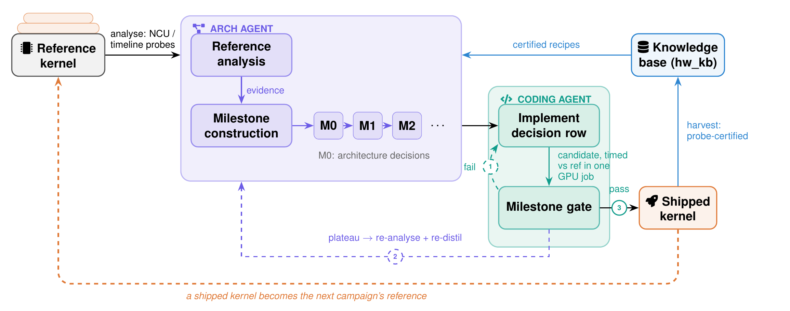

<div align="center">

# ForgeKernel：自进化 GPU 算子，追上并超越专家与 Agent

[English](README.md) | **中文**

[](#快速开始)
[](docs/design/v1-launch.md)

[](LICENSE)
[](pyproject.toml)



</div>

ForgeKernel 是一个**自进化的 GPU 算子 agent**，从一个**参照 kernel** 出发。它通过运行、计时、
剖析读出参照的架构，把它整理成一份「架构优先」的 milestone 课程
交给 coding agent 实现，并**把每个被接受的 kernel 提升为下一轮的参照**，让优化越过目前最好的实现继续往前走。
经硬件探针认证的结论沉淀进一个**跨算子共享的知识库**。论文中，ForgeKernel 在 Hopper 与 Blackwell
上的 27 个算子里，追平或超过 **22 个专家库 kernel 中的 18 个**（FlashAttention-4、cuDNN、
DeepGEMM 等），并追平或超过三个 kernel 生成系统公开的**全部 7 个 kernel**，最高 **+170.6%**
（几何平均 +39.4%）。这些 kernel 公开在 [`kernels/`](kernels/) 中。

ForgeKernel 属于 **Forge 家族**，同一家族的项目还有
[ForgeTrain](https://github.com/OpenBMB/ForgeTrain) 和
[ForgeStencil](https://github.com/OpenBMB/ForgeStencil)。

## 动态

- 🏆 **[2026-10]** 我们在 NVIDIA [SOL-ExecBench](https://research.nvidia.com/benchmarks/sol-execbench)
  的 FlashInfer-Bench 榜单上取得**第一名**。
- 🏆 **[2026-10]** 我们在华为 CANN-Bench（Ascend A3）上取得**第一名**。
- 🏆 **[2026-10]** 我们在 [CANN-Bench 榜单](https://cannbench.com/leaderboard)的 Ascend 950DT
  上也取得了**第一名**。

## 亮点

- 🔁 **自进化：永远领先参照一步。** 每个被接受的 kernel 都会成为下一轮的参照，所以每一代
  都必须超过上一代；只有硬件再也给不出收益（提升低于噪声地板）时链条才停止。论文中每一个被
  提升的参照都被再次超过，单代最高 **+9.9%**，连本已远超专家库的 `/goal` agent kernel 也不例外：
  GDN prefill 最终比 FlashInfer 快 **100%**，GQA attention 前向比 FlashAttention-4 快 **29%**
  （`scripts/self_evolve.py`）。
- 🗺️ **架构优先的课程：最容易出错的决策最先定。** 最容易做错、事后改动代价最大的决策——架构
  （kernel 拆分、tile 形状、warp 分工、寄存器与共享内存预算）和编排（什么常驻、发射次序、哪段
  计算藏在哪段之下）——全部在第一个 milestone **M0** 里定下，过了 M0 的 gate 就冻结。之后的
  `M1 → Mk` 只在这个结构内调优，每个 milestone 以一组正确性、性能与机制验证线收口。当测量表明
  某个上限只有换结构才能突破时，arch agent 回头修订 M0，而不是让后面的 milestone 绕过去。
- 📚 **知识库比一次运行活得久。** 经 GPU 探针认证的硬件机制按 GPU 架构存放（`hw_kb/`），后续
  算子按需取用。

## 🤖 让 coding agent 帮你装

先 clone 本仓库，在 clone 目录里启动 Claude Code（或任何能执行命令的 coding agent），粘贴下面这段：

```text
阅读当前目录下的 README_zh.md，
在这台机器上装好 ForgeKernel：装进虚拟环境，按我的 GPU（本机，
或我指定的 ssh 主机）写好 local.env，然后运行 `forge new tasks/rmsnorm --dry-run`，
把它打印的计划给我看。
```

## 快速开始

**环境要求。** 运行 `forge` 的机器：Linux 或 macOS、Python ≥ 3.11、git，以及
[Claude Code](https://docs.claude.com/en/docs/claude-code/overview) CLI（已登录，或设置
`ANTHROPIC_API_KEY`）；任务没有参照时还需要 tmux。GPU 机器（同一台或一台 ssh 主机）：NVIDIA
Hopper（`sm90`）或 Blackwell（`sm100`）GPU，`python3` 带 CUDA 版 PyTorch，CuTe DSL 任务还需要
`nvidia-cutlass-dsl`；建议装 Nsight Compute（`ncu`），没有它时运行只按计时推进。

**1. 安装**

```bash
cd ForgeKernel                   # 本仓库的 clone
python3 -m venv .venv && source .venv/bin/activate
pip install -e .
pip install nvidia-cutlass-dsl   # 建议安装，见下
forge --version                  # forgekernel 0.1.0
```

coding agent 离线工作；把 `nvidia-cutlass-dsl` 装在 ForgeKernel 旁边，它才能读到要用的 CuTe
DSL API。

**2. 告诉它 GPU 在哪**

```bash
cp local.env.example local.env
# FK_DELIVERY=local -> 本机的 GPU（FK_GPU 指定哪一张）
# FK_DELIVERY=ssh   -> REMOTE_HOST（免密登录的 ssh 别名）和
#                      REMOTE_WORKDIR（主机上的一个目录）
```

**3. 跑示例任务**：把 PyTorch 版 RMSNorm（每次调用 9 次 kernel launch）融合成一个 Blackwell 上
的 CuTe DSL kernel（Hopper 上把 `task.toml` 里的 `arch` 改成 `"sm90"`）。

```bash
forge new tasks/rmsnorm --dry-run                       # 检查任务、打印计划
forge new tasks/rmsnorm                                 # -> .artifacts/rmsnorm_<id>
tmux new -s forge 'forge run .artifacts/rmsnorm_<id>'   # 一次运行要几个小时
forge status .artifacts/rmsnorm_<id>                    # 查看进度
forge run .artifacts/rmsnorm_<id>                       # 中断后续跑
```

运行达到目标时 `forge run` 返回 0（循环因达到目标而停，或最好 kernel 的最终确认达到目标），否则返回 2。

**预期输出。** 运行依次写判据、拿参照校准判据、测参照、蒸馏 milestone，然后迭代，直到 kernel
达到参照的 1.2 倍或预算用完。结束时生成 `.artifacts/rmsnorm_<id>/report.md`，最好的 kernel 在
`.artifacts/rmsnorm_<id>/best/kernel.py`。我们在 B200 上跑这个示例，约 1.5 小时后停在 PyTorch 参照的
**5.2 倍**：

```text
- task: rmsnorm (source mode)
- best: 77856a9d9561 -- device median 0.0307 ms, 5.2363x the reference
- kernel: best/kernel.py
```

> 启动面完整说明 → [docs/design/v1-launch.md](docs/design/v1-launch.md)

## 工作原理

<div align="center">

</div>

一次运行有两层循环。**内层**里 coding agent 每次实现 milestone 的一行决策，一个 GPU 作业完成
判对错、和参照同作业计时、剖析；正确性不过就回退。**外层**里，连续几轮没有新最好、决策图用尽
或卡在 gate 上时，arch agent 重新介入：给杠杆定价、跑判决探针、修订课程。交付的 kernel 可以成为
下一轮的参照，探针认证的结论进入知识库。

三个产物承载这些工作，它们之间的边界保证参照的代码不会进入 kernel：每个算子的 **milestone**
（决策、参数与契约，从不含实现体）、**硬件知识库**（与算子无关的机制，唯一含代码的产物），以及
**meta-milestone**（[`meta_milestone.md`](meta_milestone.md)，蒸馏策略）。论文术语与代码的对应：

| 论文 | 本仓库 |
|---|---|
| arch agent | *teacher*（`task.toml` 的 `[agent.teacher]`） |
| coding agent | *student*（`[agent.student]`） |
| campaign | 一次运行，`.artifacts/<op>_<id>/` |
| 知识库 | `hw_kb/cutedsl/`（CuTe DSL）、`hw_kb/cuda/`（CUDA C++） |

> 设计说明 → [docs/design/milestone-distillation.md](docs/design/milestone-distillation.md)，
> milestone 格式 → [docs/milestones-template.md](docs/milestones-template.md)

## 编写任务

`forge init <op>` 把 `tasks/_template/` 复制成 `tasks/<op>/`，里面三个文件要填：

- `description.md`：完整描述算子（签名、语义、合法输入）。teacher 只凭这个文件写正确性判据。
- `shapes.json`：要优化的 shape；每个 shape 的每个输入组都会判对错和计时。
- `task.toml`：语言（`cutedsl` 或 `cuda`）、GPU 架构、参照、目标、模型、预算。

参照决定模式：

| `[reference]` | 模式 | teacher 能看到什么 |
|---|---|---|
| `run` + `source` | `source` | 参照的源码与硬件行为 |
| 只写 `run`，或 `blackbox = true` | `blackbox` | 只有硬件行为 |
| （不写） | 生成 | 先由 `/goal` 会话写出参照 |
| 改写 `[leaderboard]` | 榜单 | 榜单的题目、判据与计时 |

和 ForgeTrain 一样，任务只写与 `global_config/` 不同的部分，`global_config/` 是所有任务合并的底层：
`models.toml` 定 `[agent]`（`backend`、`provider`、`model`、`effort`、`timeout_s`；`[agent.teacher]` /
`[agent.student]` 只改一个 agent），`loop.toml` 定 `[target]` 与 `[budget]`，`backends.toml` 列出
`provider` 不是 `native` 时可以指定的 API 端点，key 从 `local.env` 读。默认目标是 device 时间达到参照的
1.2 倍，内层循环 4 小时，teacher 3 轮，两个 agent 都用 `claude-opus-5-5`（论文的运行里 arch agent 用
Claude Fable 5.1，coding agent 用 Claude Opus 5）。

## 自进化

```bash
python scripts/self_evolve.py tasks/<op> [--step 1.05] [--max-gen N]
```

每一代都是一次普通的运行（`forge new`，然后 `forge run`）。一代结束时，若确认过的最好 kernel 比它的
参照快出噪声地板以上，脚本就把下一代写成新任务 `tasks/<op>-g<k>/`：同样的 `task.toml`、
`description.md` 和 `shapes.json`（以及 `inputs/`），最好的 kernel 拷进它的 `reference/`，目标设为新参照
速度的 `--step` 倍（默认 1.05）。每一代的任务自成一体，可以提交进 git、在别处重跑。只有硬件再也给不出
收益时链条才停止：某一代的提升落在噪声地板之内（噪声地板取这一代同作业确认比值的离散度，至少 1.5%），
或某一代结束时没有确认过的最好 kernel。不设 `--max-gen` 就不限代数。被提升的
kernel 带着源码，所以第一代之后的每一代都以 `source` 模式运行：teacher 读上一代的最好版本，student 读
不到。（目前只支持 CuTe DSL 任务。）

## 榜单任务

```bash
forge init rms --leaderboard flashinfer-bench --dataset <flashinfer-trace> \
    --definition <definition> --workload <workload>
forge new tasks/rms                                  # -> .artifacts/rms_<id>
forge run .artifacts/rms_<id>
forge export .artifacts/rms_<id> --out solution.json
```

任务冻结了榜单上的题目：输入、容差与计时都按榜单自己的评测代码来。
→ [docs/leaderboards.md](docs/leaderboards.md)

## 算子代码

[`kernels/`](kernels/) 公开了论文里 ForgeKernel 生成的 kernel（24 个，CuTe DSL，H100 与 B200），
以及论文之后生成的一个（DeepSeek-V4.1 融合稀疏 attention prefill，CUDA C++，B200 上是 FlashMLA 的 1.10×）。
先按算子类型分类，再按算子和 GPU 分目录：

| 目录 | 算子 |
|---|---|
| [`attention/`](kernels/attention/) | attention 前向（含自进化各代）与反向、GQA 与 MLA paged decode、MLA paged prefill |
| [`sparse_attention/`](kernels/sparse_attention/) | DeepSeek 稀疏 attention（DSA）反向、score 重算与 indexer 反向；DeepSeek-V4.1 融合 prefill |
| [`linear_attention/`](kernels/linear_attention/) | Gated DeltaNet prefill 前向与反向、变长 prefill；循环式 Kimi Delta Attention prefill |
| [`gemm/`](kernels/gemm/) | 16 位稠密 GEMM、FP8 GEMM、FP8 × FP4 grouped GEMM（MoE） |
| [`conv/`](kernels/conv/) | Conv2d 权重梯度与数据梯度、Conv3d 前向 |

每个 kernel 的加速、对比对象与运行环境见 [kernels/README_zh.md](kernels/README_zh.md)。

## 实验环境

论文实验使用的 GPU 与软件如下。大部分实验用的是每种 GPU 的主镜像：

| | Hopper | Blackwell |
|---|---|---|
| GPU | NVIDIA H100 80 GB HBM3 SXM，132 个 SM（`sm_90a`） | NVIDIA B200，180 GB HBM3e，148 个 SM（`sm_100a`），1000 W，SM 最高频率 1965 MHz |
| 驱动 | 550.90.07 | 580.105.08 |
| CUDA toolkit | 12.8 | 13.1（`nvcc` 13.1.115） |
| PyTorch | 2.6.0a0（NGC 25.01） | 2.10.0+cu130 |
| CuTe DSL（`nvidia-cutlass-dsl`） | 4.4.2 | 4.4.2 |
| Nsight Compute（`ncu`） | 2025.1 | 2025.4.1 |
| cuDNN | 9.7 | 9.19.1 |

另有一部分实验用的是第二个镜像：H100 上是 CUDA 13.1、PyTorch 2.10（NGC 25.12）、CuTe DSL 4.6.1；
B200 上是 CUDA 13.0、PyTorch 2.13、CuTe DSL 4.6.2，Nsight Compute 2025.3.1。所有报告的提升都是
参照与候选在同一个 GPU 作业里计时得到的，因此比较结果不受实验所用镜像的影响。

## 仓库结构

目录结构与 ForgeTrain 一致：

```text
src/forgekernel/     harness：CLI、任务与运行、两层循环、GPU 作业
global_config/       配置的底层：models.toml、loop.toml、backends.toml
tasks/               <op>/：task.toml、description.md、shapes.json、reference/；
                     _template/（`forge init` 复制的模板）、rmsnorm/（可直接运行）
.artifacts/          运行目录，不进 git：<op>_<id>/{run.json, ws/, report.md, best/, ...}
skills/              agent 用的工具，每个一份 SKILL.md 加脚本，每轮开始前镜像到
                     agent 工作目录的 .claude/skills/
meta/                teacher 与 student 的 prompt（meta/cuda/：CUDA C++）
hw_kb/               硬件知识库（cutedsl/、cuda/），按 GPU 架构组织
docs/                设计说明、milestone 模板、榜单、知识库收割
scripts/             agent 启动脚本、/goal 驱动、自进化
tests/               pytest 测试（只需 CPU）
kernels/             ForgeKernel 生成的 kernel，按算子类型分类
```

## 参与贡献

欢迎各种形式的贡献：bug 报告、功能建议、pull request、文档与翻译。提交改动前请跑测试
（`pip install pytest torch safetensors`，然后 `pytest`；不需要 GPU）。知识库条目需要一个 GPU
探针来认证，见 [docs/kb-harvest.md](docs/kb-harvest.md)。

## 局限

- **有参照时效果最好。** 只给 PyTorch 实现和一个 device 时间数字时，论文消融里测的三个算子全部
  停滞；ForgeKernel 更擅长超过已有的实现，而不是写出第一版实现。
- **平台是估计，不是证明。** 自进化停在同作业噪声地板：说明这个循环找不到更多，不代表没有更多。
- **覆盖范围。** 四类算子、两代 NVIDIA GPU；与这些差异较大的稀疏模式和存储层次尚未测试。
- **成本。** 一次运行要数小时的 GPU 时间和前沿模型用量；agent 在 driver 写好的策略内以跳过权限
  确认的方式运行，请在专门的机器上使用。

## 许可证

Apache License 2.0，见 [LICENSE](LICENSE)。榜单评测器改编了 FlashInfer-Bench 与 SOL-ExecBench
（均为 Apache-2.0）的代码，见 [NOTICE](NOTICE)。

## 致谢

ForgeKernel 建立在 [CUTLASS 与 CuTe DSL](https://github.com/NVIDIA/cutlass)、
[Nsight Compute](https://developer.nvidia.com/nsight-compute)、
[Claude Code](https://docs.claude.com/en/docs/claude-code/overview)、
[FlashInfer-Bench](https://huggingface.co/datasets/flashinfer-ai/flashinfer-trace) 与
[SOL-ExecBench](https://huggingface.co/datasets/nvidia/SOL-ExecBench) 之上，并以 FlashAttention、
DeepGEMM、FlashMLA、FlashInfer、cuDNN 与 cuBLAS 的专家 kernel 为对照。
